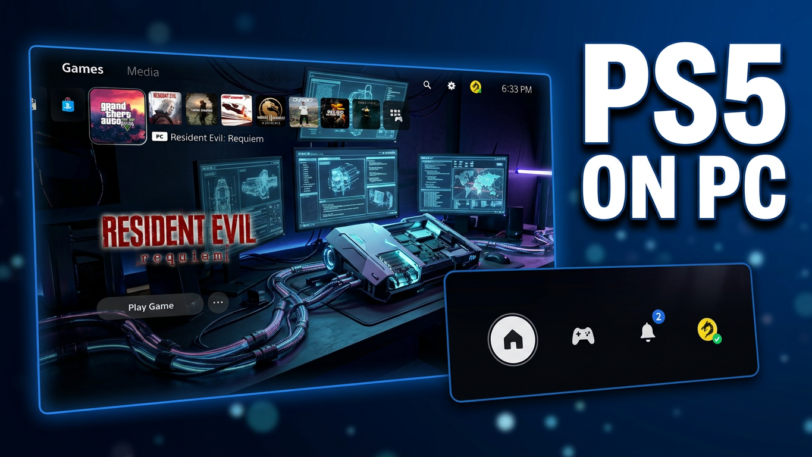

# PlayOSX

**لانشر ألعاب للويندوز بواجهة بتشبه PS5 ومصمم للتحكم بالذراع.**

   

[English](README.md) · **العربية** · [Français](README.fr.md) · [Deutsch](README.de.md) · [Español](README.es.md) · [Português](README.pt.md)

---

## معاينة

  

### شاهد العرض التوضيحي

  

## نبذة

PlayOSX بيحوّل جهازك لكونسول في الصالون. كل حاجة مصممة للذراع: شاشة رئيسية سلسة بشكل PS5، وصفحة لكل لعبة بالأرتوورك، وأوفرلاي أثناء اللعب وقائمة سريعة. وكل ألعابك (Steam وEpic والمحاكيات والاختصارات) في مكان واحد.

## المميزات

- **واجهة بشكل PS5**: لوجو تشغيل متحرك، خلفية bokeh، صور كبيرة للألعاب، كاروسيل سلس وأصوات.
- **مكتبة واحدة لكل حاجة**: Steam (حتى الألعاب المملوكة وغير المثبتة)، Epic، اختصارات سطح المكتب ومحاكيات Nintendo Switch (yuzu وفروعه).
- **صفحة اللعبة**: أرتوورك من SteamGridDB، تفاصيل Steam (الوصف وMetacritic والمتطلبات) وموسيقى خاصة بكل لعبة.
- **أوفرلاي أثناء اللعب وقائمة سريعة**: نافذة شفافة فوق كل شيء، ومفيش أي حاجة بتتحقن في اللعبة أو تتقرأ منها.
- **تسجيل ومقاطع** عن طريق OBS Studio بيشتغل بصمت في الخلفية.
- **أدوات الذراع**: دعم DualSense، تغيير الأزرار لكل لعبة، منحنى الزناد، الاهتزاز، اللايت بار، الذراع كماوس وpassthrough.
- **أوفرلاي الأداء**: FPS والحرارة والرام، وخطط الطاقة في ويندوز.
- **اجتماعي**: أصدقاء Steam، التحكم بصوت Discord وشاشة تنزيلات وتحديثات Steam.
- **ثيمات الصوت**: حزم أصوات Steam Deck من deckthemes.com (أو ملف .zip / مجلد محلي).
- **جدولة الإضاءة الليلية**، شاشة الخمول، ملفات مستخدمين بـ PIN، وتحديثات من GitHub Releases.

## ⚠️ تنبيه

PlayOSX مشروع مستقل من محبي PlayStation، وغير تابع لشركة Sony Interactive Entertainment أو معتمد منها. PlayStation وPS5 علامات تجارية لأصحابها.

