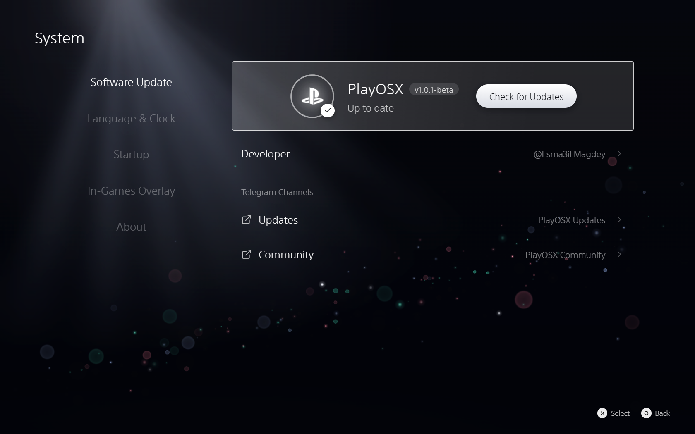
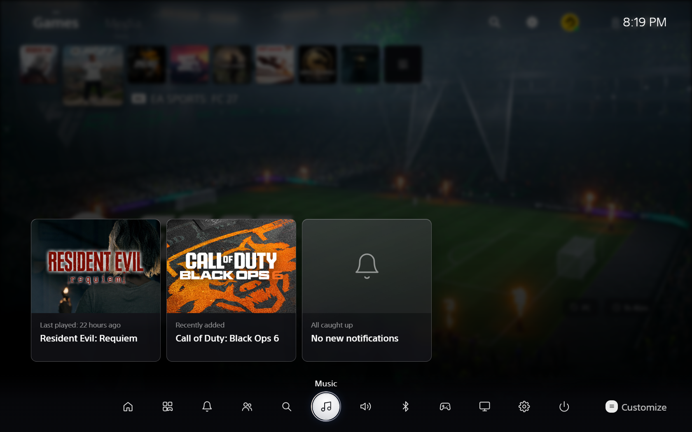

# PlayOSX

**A controller-first game launcher for Windows with a PS5-style interface.**

  

**English** · [العربية](README.ar.md)

---

## Preview

  
  
  

### Watch the demo

  

## About

PlayOSX turns your PC into a living-room console. Everything is built for a controller: a smooth PS5-style home screen, a game hub with artwork, an in-game overlay and a quick menu. All your games (Steam, Epic, emulators, shortcuts) live in one place.

## Features

- **PS5-style interface**: animated boot logo, bokeh background, hero artwork, smooth tile carousel and sounds.
- **One library for everything**: Steam (including owned but not installed), Epic, desktop shortcuts and Nintendo Switch emulators (yuzu and its forks).
- **Game hub**: artwork from SteamGridDB, Steam details (description, Metacritic, requirements) and per-game theme music.
- **In-game overlay and quick menu**: a transparent always-on-top window; nothing is injected into or read from the game.
- **Capture and clips** through OBS Studio, running silently in the background.
- **Controller tools**: DualSense support, button remap per game, trigger curve, rumble, lightbar, controller-as-mouse and passthrough.
- **Performance overlay**: FPS, temperatures and RAM, plus Windows power plans.
- **Social**: Steam friends, Discord voice control and Steam downloads / updates screen.
- **Sound themes**: Steam Deck sound packs from deckthemes.com (or a local .zip / folder).
- **Night Light schedule**, idle screen, user profiles with PIN, and updates from GitHub Releases.

## ⚠️ Disclaimer

PlayOSX is an independent fan project. It is not affiliated with or endorsed by Sony Interactive Entertainment. PlayStation and PS5 are trademarks of their respective owners.
